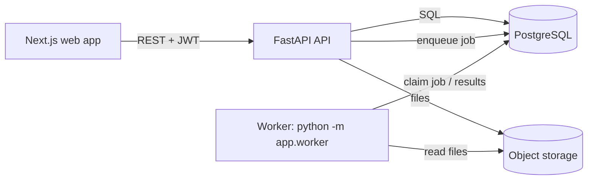

# Architecture

Phase 1 ships four runtime components: the Next.js web app, the FastAPI API, the worker and PostgreSQL. Uploaded files go to object storage (local disk in Phase 1). Later phases add the AI engine (inside the worker), a sandboxed Playwright runner and a Playwright MCP gateway.



## Backend layout

```
backend/app
  api/deps.py         current user, project-role dependencies (Viewer / Engineer / Admin / Owner)
  api/v1/             routers: auth, projects (+members, roles), modules, documents (+files), activity (+jobs, dashboard)
  core/               settings, security (Argon2id, JWT, signed URLs), errors (RFC 9457), pagination, rate limit, logging
  database/           engine/session, declarative base, Alembic migrations
  models/             SQLAlchemy models
  schemas/            Pydantic request/response models
  repositories/       project access queries (membership-scoped)
  services/           domain logic: auth, projects, modules, documents, file types, jobs, activity
  integrations/       storage (local driver; S3 driver slots in behind the same protocol)
  worker/             job runner and handlers
```

Routers stay thin: they declare the required role, call one service, commit, and wrap the result. Services hold the rules (archived projects are read-only, last owner cannot leave, duplicate files are rejected) and write the audit log in the same transaction as the change.

## Authentication

- Passwords: Argon2id. Unknown emails are verified against a dummy hash so timing does not reveal which accounts exist.
- Access token: HS256 JWT, 15 minutes, held in browser memory only.
- Refresh token: random 48-byte token in an httpOnly, `SameSite=Strict` cookie scoped to `/api/v1/auth`; only its SHA-256 is stored. Every refresh rotates it. Presenting an already-rotated token revokes the whole token family (theft detection).
- Login: rate-limited per IP and per email (5/minute), account locks for 15 minutes after 10 failures.
- Password change revokes all refresh tokens.

## Authorization and project isolation

Roles are per project: Owner (40) > Admin (30) > QA Engineer (20) > Viewer (10). Each project route declares its minimum role through a dependency that loads the caller's membership for that project.

- Not a member, or the project is deleted: **404**, so project IDs are never confirmed to outsiders.
- Member below the required role: **403**.
- Every child lookup (module, document, version) filters by the project ID from the URL, so an ID from another project never resolves.
- Archived projects are read-only for everyone (409 `project_archived`) until restored.
- Download links are HMAC-signed, expire after 5 minutes, are bound to one user, and re-check membership when used.

`backend/tests/test_isolation.py` walks the OpenAPI schema and calls **every** project-scoped route as a non-member, asserting 404 and that no data changed. New routes are covered automatically.

## Background jobs

The `jobs` table is the queue. The worker claims the oldest queued job with `FOR UPDATE SKIP LOCKED`, so any number of workers can run. A handler failure is retried up to 3 attempts; a `JobError` fails immediately with a user-facing message. Jobs left running by a crashed worker are re-queued after 10 minutes. This replaces the Redis/arq queue in the blueprint: one less service, and jobs survive restarts.

Phase 1 has one job, `document_ingest`: plain text, Markdown, CSV and JSON are extracted into `document_extractions`; PDF, DOCX, XLSX and images are stored and marked `stored` until the Phase 2 parsers exist.

## Uploads

1. Streamed to a temp file while hashing (SHA-256) and enforcing `MAX_UPLOAD_MB` (413).
2. Type check: allowed extension **and** matching content (PDF magic bytes, PNG/JPEG/WebP signatures, DOCX/XLSX zip structure, UTF-8 text without NUL bytes, parseable JSON) (415).
3. Duplicate check by hash within the project (409 with the existing document ID).
4. Stored under a server-generated key; the client filename is sanitised and kept only as metadata.
5. A `document_ingest` job is queued in the same transaction.

## Frontend

- App Router with route groups: `(auth)` for sign-in/registration and `(app)` for the authenticated shell.
- `lib/api.ts`: one fetch wrapper. Adds the bearer token and `If-Match`, refreshes once on 401 (shared promise so parallel requests refresh once), parses problem details into `ApiError`.
- `lib/queries.ts`: TanStack Query hooks. Document lists poll every 2 s only while a version is queued or processing.
- Every page handles loading, empty, error and success states. Write controls are hidden by role, but the API is the authority.
- Theme: CSS variables for light and dark, applied before first paint by an inline script.

## Changes from the blueprint

| Blueprint | Phase 1 | Why |
| --- | --- | --- |
| All 34 tables in the first migration | 13 tables needed now; later tables arrive with their phase | Unused tables would freeze design decisions before the features exist |
| arq on Redis | PostgreSQL job table | Fewer moving parts; durable; enough for current load |
| PostgreSQL row-level security | Membership check in every query + isolation test suite | RLS needs per-request DB roles; planned for Phase 6 hardening |
| S3 + local storage | Local driver behind a `Storage` protocol | S3 driver ships when a deployment needs it |
| SSE job progress | Polling | Simpler; SSE when AI jobs need finer progress |
| pnpm | npm | npm ships with Node; lockfile committed |
| `organizations` table | Not created | Tenancy decision still open |
